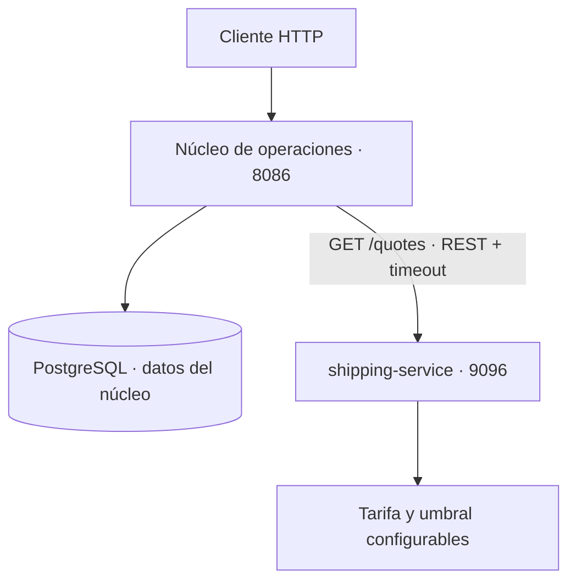
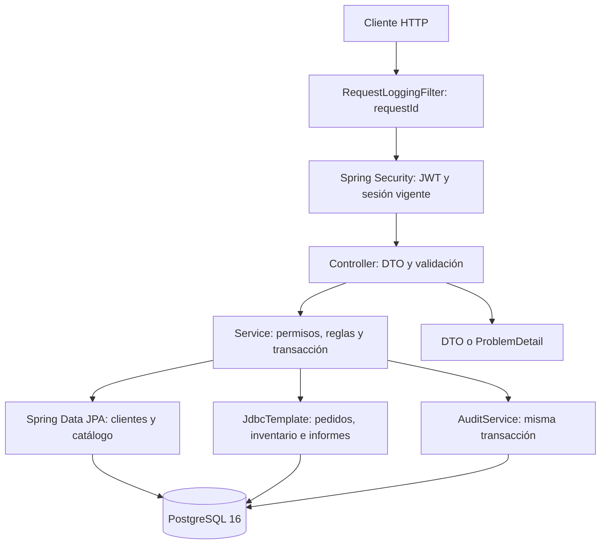

# Arquitectura y recorrido de una petición

Dos aplicaciones Java 21 / Spring Boot 3.5, cada una con su JAR e imagen. El núcleo conserva paquetes por responsabilidad funcional: `security`, `customer`, `product`, `inventory`, `order`, `report`, `shipping`; `common` reúne errores, paginación, auditoría, OpenAPI y correlación HTTP. `services/shipping-service` es un servicio autónomo de cálculo de cotizaciones, sin acceso a PostgreSQL ni dependencia Java compartida con el núcleo.

En Kubernetes, `backend-app` resuelve `shipping-service` mediante su Service interno. Cada aplicación tiene Deployment, probes, imagen y build propios. El presupuesto es puro; el resultado se guarda con el pedido en la transacción local del núcleo. El diagrama siguiente muestra el recorrido interno del núcleo:

El filtro de correlación se ejecuta antes que seguridad, de modo que también los 401 tienen identificador. Spring Security verifica firma HS256, issuer, vencimiento y vigencia de la sesión en PostgreSQL. La autoridad se lee del usuario activo en base de datos; un cambio de rol no espera a que caduque el JWT.

Los controllers traducen HTTP a operaciones. Bean Validation rechaza estructuras inválidas; los servicios aplican invariantes y delimitan transacciones. No se serializan entidades JPA. `spring.jpa.open-in-view=false` evita consultas perezosas durante la serialización. `ApiExceptionHandler` produce errores estables con código y requestId.

## Persistencia mixta y transacciones

Clientes y productos usan entidades con `@Version`, repositorios Spring Data y DTO. Las operaciones de stock usan SQL explícito porque requieren orden de bloqueo, `FOR UPDATE`, operaciones aritméticas y comprobaciones entre tablas. Ambos mecanismos comparten datasource y el gestor de transacciones de Spring: los movimientos y la auditoría se confirman o revierten con la operación.

`OrderCompletionService` coordina dos fases: lee un pedido confirmado, solicita una cotización HTTP sin mantener bloqueos PostgreSQL y llama a la transacción final. Esta bloquea el pedido y vuelve a comprobar estado y versión antes de consumir stock. Una cancelación concurrente invalida la finalización. La cotización es una consulta sin efectos externos, por lo que no requiere transacción distribuida.

## Límites de módulos

- Seguridad administra cuentas, sesiones y autorización. No calcula importes.
- Catálogo y clientes mantienen maestros, con baja lógica y control de versión.
- Pedidos gobierna estados, cantidades y precios acordados.
- Inventario mantiene saldos, reservas y movimientos; pedidos reutiliza sus operaciones transaccionales.
- Informes usa SQL de lectura con JOIN y agregaciones; no cambia stock.
- Transporte encapsula el contrato HTTP, la validación de respuesta y los timeouts.

Las dependencias son directas y comprobables. No se añaden bus de eventos interno, capas de casos de uso vacías ni interfaces para cada clase.

## Contrato y evolución

La API usa `/api/v1`. OpenAPI se genera desde controllers y DTO; Swagger ofrece ejecución interactiva en desarrollo. Cambiar contratos requiere actualizar tests y la colección HTTP. Las migraciones existentes son inmutables una vez desplegadas: una evolución de esquema se añade como nueva versión Flyway.
